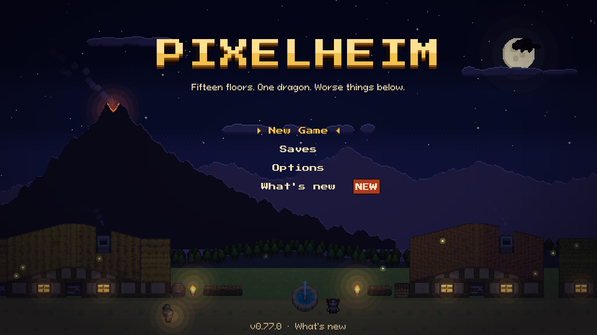
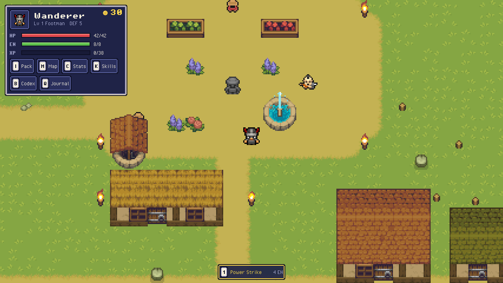
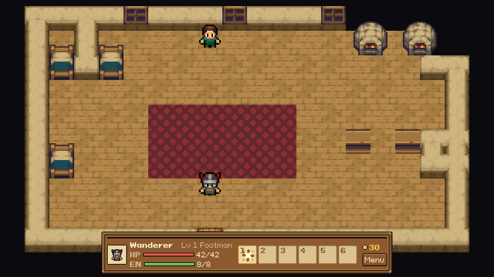
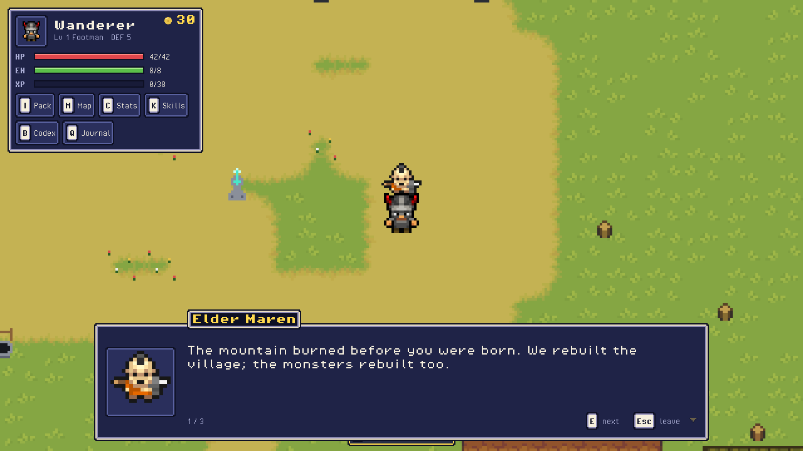
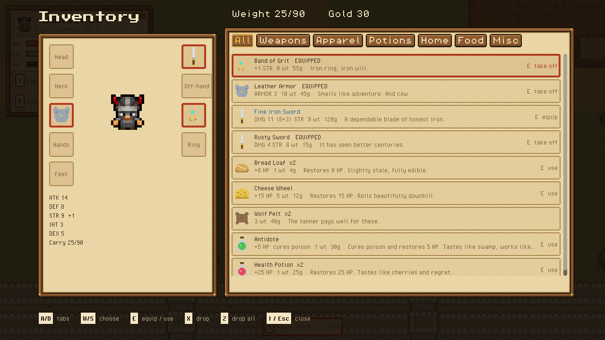

<p align="center">
  
</p>

<h1 align="center">Pixelheim</h1>

<p align="center">
  <b>A retro pixel-art open-world RPG in Godot 4.7: a village the dragon burned, the courier who stayed, the Reach's regions and the relics they keep - and the mountain last.</b><br />
  The village burned. You stayed. Currently v0.263 - 1.0 has to be earned.
</p>

---

## Play it

**https://tomklotzpro.github.io/pixelheim/** - the game, deployed to GitHub Pages on every push to `main`. It runs in the browser: keyboard, mouse or gamepad.

**On a computer** it also comes as an app for macOS and Windows, built on every push to `main` by the [Desktop app](../../actions/workflows/desktop.yml) workflow (the latest run's `pixelheim-macos` and `pixelheim-windows` artifacts). The app draws with the desktop renderer: its world is lit in high dynamic range (no banding in the night's light) and lamps and fires get a wider glow at night than the browser can afford. Its slots use the same save format as the browser's, so a save code brings a hero across either way. Neither app is signed by a store: on a Mac, open it the first time with right-click → Open; on Windows, SmartScreen's "More info" → "Run anyway".

What changed release by release: **What's new** on the title menu, or [`godot/assets/data/changelog.json`](godot/assets/data/changelog.json).

## The game

A dragon burned Pixelheim in one night, and you - the courier who came up the road with a letter for Elder Maren - stayed. Put out the fires, help the survivors rebuild, and walk out into **the Ashenreach**: the roads (safe) and the wilds (not safe), past the forest and the marsh to the Saltmere coast, the Blackiron mines, the castle of Greyhold and the Frostgate pass, each region with its people, its quests, its armour and a boss in a cave, a shaft or a cellar of its own. Fifty years ago five of the village climbed the Ashen Mountain to mend the seal that held the dragon, and only one came home. Maren never sent the letters she wrote to their families: you carry them out to the regions, where what the five left behind waits, and each answer tells her something she never knew. The mountain comes last: with the keepsakes home Maren tells it all at last and gives you the fifth letter, and past the mountain's gate the old road climbs through the ash to the forge where **Morvax**, the one who never came down, has kept the dragon asleep for fifty years. He reads the letter and the mountain shakes, and you run home to **the Night of Bells**: the five lanterns lit on the square, the embers driven off and the roofs doused, then the dragon held on the square until dawn with everyone you brought home at a job - Teo's bell, the old guard on the walls, Iva's tent, Bram's cheese down Upper Street - until the collar comes off and he flies home, free. Then Morvax asks the courier the one thing he can't ask Maren - do they want him back? - and your answer is the story's last word: **come home**, to a room at the inn and a bench by the fountain and an argument with Maren every day, or **stay with them**, up on the mountain with the three, down on festival days. Either way Fafnyr warms his belly on Hilda's forge every morning for a cheese wheel a day, and Pixelheim can grow into a City.

- **One hand-drawn world**: hero, villagers, monsters, terrain and dungeons in Shade's Puny art; the town's timber houses, its wells, fountain, lamp posts and fences, and the rooms behind its doors from his Medieval Age set, the day lying on their floors under the windows and their candles lit at night
- **Open ground that lives**: meadows in patches of lusher and drier green, tufts, clover and flowers in the grass and the wind rolling over the long grass; snow lying in drifts with blue shadows; the Mirefen's murk, sedge, reeds and still puddles
- **Burnt land**: the Ash, Blackiron and the mountain road's flats scorched in char and pale ash, cracked, with burnt tufts and cinders that glow at night and ash drifting on the wind; the rock beside them burnt, dead trees standing on it; Blackiron's outcrops worked, with shoring, carts, winches, spoil and rails laid between them
- **Real-time fights**: monsters prowl in packs and hunt you (the weak ones run from a hero far above them), other packs by night than by day (wolves, the dead and worse come out after dark, a little stronger and richer, while some day packs sleep by their camp fires); swing, cast your skills on the number keys, and watch the ailments land - on the same numbers the game has always used
- **7 classes that ascend**: every 5 levels a rank, its title and its moment in the light, and from the first rank a path that forks into 14 identities, each with a signature skill
- **Skill trees, stats and gear**: three named paths per class, stat points that explain themselves (and Old Hessa at the village's shrine to make you forget skills or training, the first time free), loot with rarities on a nine-slot paper doll, and helmets and armour you can see on your hero
- **Quests and the journal**, the **codex** of every beast you have fought, and mastery bonuses for the families you hunt
- **One land**: the Ashenreach and its six regions lie side by side; near a road out the land past it is drawn beside you, and you walk on into it with no fade - the village's gate, houses and caves stay short changes of scene
- **Roads the story opens**: each region's way in from the Reach - a rockfall on the cliff road, the river bridge burnt on the Night of Ash, Ulla's barricade, an avalanche on the Frostgate road - stays shut until the story reaches it, says what opens it, and the arrow leads there
- **A town that grows**: buy the house and furnish it, buy the shops and collect rent, fund the village into a city (its rutted dirt streets gravelled, then cobbled, the square flagged round its fountain), bank and send caravans, recruit settlers from the wilds
- **The Pixelheim Post**: once Maren's first letter reaches Saltmere a post box goes up on the square, and each morning it holds three letters and parcels between the Reach's people - seventeen threads, from Bram's Cheese Club and Pip writing to the dragon to Mirelle's gentle reminders about interest and, after the story, Maren and Morvax counting the lamps, Maren's weekly letters to the families, Morvax writing from his bench or his forge, Fafnyr's opinions on cheese and the Kings' Vault's heirlooms going home to the families whose marks they carry - for you to carry on your way (after the story Fafnyr flies the furthest piece of each day's post himself: the Dragon Post, fast, warm, occasionally on fire), read in your journal once delivered, and sometimes a reply to bring back; some leave you a recipe, a piece of furniture or a trophy, and every delivery stamps that place's page in your courier's book; the roads you carry it along grow signposts at their forks, named after whoever writes most ("Bram's Corner"), then a waystation on the town's board: built, it stands halfway down the road with a hut, a bench that mends you, a post box and an ember lamp lit at night, and you can travel to it; each morning the land round a lit lamp heals a cell further into the ash, bare earth at the ring's edge, then grass, flowers and saplings by the lamp, and inside its ring no night pack rises and the Ash's heat and embers fade; the map draws your post roads in gold; nothing in it ever spoils
- **Crafting** at the forge, the cauldron and your own workbench; foraging in the wilds
- **Music, stingers and weather** for every place, rendered from the game's own chiptune synth
- **Saves that never break**: three slots, autosave (a small quill by the clock writes when a moment is kept: a door, a chest, a quest's step, a night's sleep; the pause menu says how long ago), a backup of the save before, and save codes that carry a hero to another computer or browser (a code cut short is caught, not loaded); one the game can't read is kept, never written over. The Saves screen shows each hero as they left, with the chapter and the hours played; a hero can be duplicated, and a deleted one brought back until another hero takes the slot. A save made on the Night of Bells resumes at its beat, and one made down a dungeon wakes at the top of that floor. Until the beta the save format may change without carrying old heroes over: a save from before a change shows as an older version's, kept until you clear it
- **A story told in moments**: New Game opens on the village, the mountain waking and the five who climbed it fifty years ago; each boss rises with its name before you fight it, each letter is answered, and the ending rolls credits starring every creature you fought - all skippable
- **A title to arrive at**: Pixelheim's street at night under the Ashen Mountain, lit windows and chimney smoke below, the dragon's fire smouldering in the crater above, and your hero in the street looking up at it
- **A UI like a village ledger**: one clear pixel type throughout, parchment pages in carved wooden frames, a wooden dock along the bottom with your bars, skills and gold, and screens that ease in with the sound of turning paper
- **Comfort**: rebindable keys, gamepad, options from the title, reduced motion, CRT scanlines, a fog-of-war map with fast travel

| The village                                | Inside                          |
| ------------------------------------------ | ------------------------------- |
|  |  |

| A conversation                               | The pack                               |
| -------------------------------------------- | -------------------------------------- |
|  |  |

## Run it

You need [Godot 4.7](https://godotengine.org/download) on your `PATH` (and Python 3 for the art fetch).

```bash
scripts/fetch-private-art.sh   # once: the paid art, from the private assets repo (below)
godot --path godot             # play (or open godot/ in the Godot editor)
```

```bash
godot/tools/check.sh quick                                    # before a pull request: what the diff could break, headless, under a minute
godot/tools/check.sh full                                     # everything CI runs, side by side
godot --headless --path godot --import                        # after adding assets or scripts
godot --headless --path godot -s res://addons/gut/gut_cmdln.gd # the unit tests (GUT)
godot/tools/flows.sh                                          # the release flows, with screenshots (--quiet: headless)
godot/tools/flows.sh --boot                                   # every map booted, by day and at night
python3 godot/tools/synth.py                                  # re-render the generated sounds and themes
python3 godot/tools/vignettes.py <pixelheim-assets checkout>  # re-lift Shade's furnished corners for the rooms
python3 godot/tools/mapgen.py                                 # maps from their sketches in godot/maps-src/
```

**Paid art.** The town's houses, props and rooms use Shade's paid _Puny World Medieval Age_ pack, and the item, skill and ailment icons come from his paid icon packs (with his free CC0 ones). None of the paid art may be redistributed, so it lives in the private `TomKlotzPro/pixelheim-assets` repository (`retro-rpg/shade/`). `scripts/fetch-private-art.sh` installs it with your GitHub login, and the deploy fetches it with a read-only deploy key. Without it the game still runs on Shade's free art alone: the town's houses, props and paid icons are missing (its street lamps, drawn in his palette in code, still stand), and the rooms are built from his free dungeon and world sheets, their walls, floors, doors, windows, stairs and the furniture that has a free likeness (a harness run's `cc0` holds the pack back to check it).

More on the Godot project - the save format, the screenshot harness, the release flows, web export - in [`godot/README.md`](godot/README.md).

## How it works

```text
godot/                 the game (Godot 4.7, GDScript)
  scripts/
    state/             the rules and the save: GameState (autoload) and pure static classes
                       - SaveCodec, Bestiary, Economy, Skills, Quests, Town... - tested with GUT
    world.gd           the play: actors, the HUD, interaction, combat, music
    map_view.gd        a map as drawn: ground, houses, rooms, dungeons, props, chests
    *_screen.gd        menus and screens, all styled by ui_style.gd
    puny_*.gd          Shade's art laid over the maps: terrain, dungeons, the town, props, rooms
  assets/              art (Shade's CC0 packs), fonts, audio, and the game's data:
    data/              items, monsters, quests, villagers, the town, the changelog (JSON)
    maps/              every map, one row of tiles per line (JSON); new ones drawn as sketches in godot/maps-src/
  test/unit/           GUT tests
  tools/               the release flows, the icon, the sound synth, the room vignettes
scripts/               fetch-private-art.sh, which installs the paid art
docs/                  screenshots, and the reports behind two big changes (Solid Ground, the Undermountain)
```

- **Rules are pure.** Game rules live in static GDScript classes with no nodes, so they test fast; scenes draw, move and route input. Everything that persists changes only through `GameState`.
- **The data is edited where it lives.** Maps (`godot/assets/maps/`, or a sketch in `godot/maps-src/` run through `mapgen.py`) and data tables (`godot/assets/data/`) are the source; the unit tests check every map file (known tiles, the spawn and every way's landing on open ground, the packs in their regions) and every chest (its own id, known loot, clear of the packs).
- **Our own save format.** Saves are Pixelheim's own (v5): a section for each part of the game, a card the Saves screen reads alone, the fog of war packed a bit per cell (a fully explored hero's save is 9 KB, written in about a millisecond), and every write read back before it replaces the last. Until the beta a change that old saves can't take bumps the version, with no migration; compatibility comes back at the beta.
- **The look lives in one place.** `ui_style.gd` draws every window and picks every font size; pixel fonts render at whole sizes only.
- **Verified by playing.** Besides the unit tests, `godot/tools/flows.sh` walks the release flows (spawn, doors, chests, shops, crafting, quests, rank-ups, fights, death, saves, conversations, smooth walking) through a real window and checks each one, several at a time, each the same run every time (stepped on the game's own clock, with the same dice, and hunted for flakes every night); every pull request runs them headless, and boots every map by day and at night, after the unit tests, and runs them again in a virtual window beside that, leaving every flow's picture and the look book on the pull request (on Shade's free art only).

## History

Pixelheim began as a React + TypeScript + PixiJS game in the browser. It moved to Godot in v0.66, the web edition was retired in v0.75, and its last traces (the browser hero import, the old `/classic/` links, the record of the port) went in PIX-301. Its maps and data tables live with the game now (`godot/assets/`) and are edited there; everything it was is in this repository's history.

## Roadmap ideas

- [x] Shops, crafting, a house to own, a town that grows
- [x] The Undermountain: floors 11-15 and a second boss (retired with the old mountain's floors and the Deep Hunt for the main story's end)
- [x] Dungeons in floors in every region, and the Kings' Vault after the story
- [x] A harder climb, with gear to buy for every class at every stage
- [x] Skill trees, ranks and paths
- [x] Music, ambience and sound
- [x] The move to Godot, with one artist for the whole world
- [x] Worn gear drawn on the hero
- [ ] Touch controls for phones
- [ ] More regions beyond the Ashenreach
- [ ] 1.0, eventually - it has to be earned

## License

The code is MIT. The art in `godot/assets/puny/` is Shade's CC0 work (see its `LICENSE.txt`); his paid packs (Medieval Age and the icon packs) are licensed to the author and kept private. Fonts: Pixeloid (OFL) and Press Start 2P (OFL).
